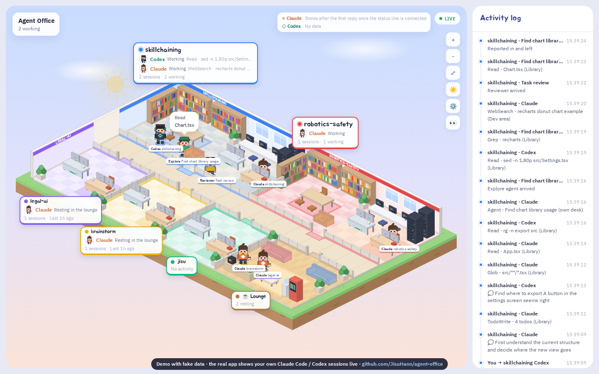

# 🏢 Agent Office

Watch what **Claude Code** (and Codex) are doing as tiny pixel characters in a browser office.
Each project gets its own coloured room. Characters walk to their desk when they work, and head to the lounge when they have nothing to do.

> **Based on [toplainsoft/claude-office](https://github.com/toplainsoft/claude-office)** (MIT, © TOPLAIN SOFT) — the original idea, log parser and isometric renderer come from there. This repo is a modified fork; see [what changed](#what-changed-from-the-original).

**▶ [Live demo (fake data)](https://jisuhann.github.io/agent-office/)** — the demo replays scripted fake sessions. The real app shows *your own* sessions, live, from your own machine.



- No dependencies — just [Node.js](https://nodejs.org) 18+
- Spends no tokens or money. It only *reads* the log files already on your computer
- Local by default (`127.0.0.1`). Nothing is sent to the internet

## What changed from the original

- Single house with one room per project instead of a multi-floor building; two big rooms (`skillchaining`, `robotics-safety`) plus small rooms and a lounge
- A colour per project, idle workers walk to the lounge
- Chibi pixel characters, Helvetica Neue, English UI
- Remote access without a token by default (opt-in `HOST`), GitHub Pages demo with fake data

## The house

One house, one room per project (rooms are matched by working-folder name):

| Room | Colour | Size |
|---|---|---|
| `skillchaining` | 🔵 blue | big (top, left) |
| `robotics-safety` | 🔴 red | big (top, right) |
| `legal-ai` | 🟣 purple | small |
| `brainstorm` | 🟡 yellow | small |
| `jisu` (home-folder sessions) | 🟢 green | small |
| ☕ Lounge | 🟤 brown | shared — idle workers walk here |

- Every room has the project colour on its floor, wall band, door mat, shoulder stripe, the ring under each character's feet and its name tag, so you can tell at a glance who belongs where.
- Big rooms (12 tiles wide) have a **library** (reading/searching) and a **dev area** (editing, commands, servers). Small rooms have a few desks.
- A worker idle for ~25 s goes back to their desk; after ~40 s they walk through the hall to the lounge with a ☕. A new event sends them back to work.
- Helpers (Explore, Plan, general-purpose, the Codex reviewer) come in through the room's door, report, and leave.
- A question 🙋 or error ⚠ lights up the room's name tag. Errors clear when you click the tag.
- Click a name tag to zoom into that room; drag to pan, wheel to zoom, double-click to fit.

To add or rename a project room, edit the `PROJ` list near the top of the script in `office.html` (`name` must equal the working-folder name).

## Quick start

```bash
# this project lives in a folder of the author's site repo, so fetch only that folder:
git clone --depth 1 --filter=blob:none --sparse https://github.com/JisuHann/JisuHann.github.io
cd JisuHann.github.io && git sparse-checkout set agent-office && cd agent-office
node server.js          # opens http://localhost:4777
```

Then run `claude` in any project folder in another terminal. On first launch a setup window asks for an office name and your name (also saved in `office.json`, which is git-ignored).

No Claude Code at hand? Try it with fake sessions: `node demo.js`.

Options:

```bash
PORT=4778 node server.js                      # other port
node server.js --no-open                      # don't open the browser
CLAUDE_PROJECTS_DIR=/path node server.js      # Claude logs elsewhere
CODEX_SESSIONS_DIR=/path node server.js       # Codex logs elsewhere
NO_CODEX=1 node server.js                     # ignore Codex
```

### Remote access (optional)

```bash
HOST=0.0.0.0 PORT=4777 node server.js --no-open
```

- No token by default: anyone who can reach the port can see the office. To lock it: `OFFICE_TOKEN=secret HOST=0.0.0.0 node server.js`, then open `http://<host>:4777/?token=secret`.
- It is plain HTTP. On untrusted networks use an SSH tunnel (`ssh -L 4777:localhost:4777 host`) or bind to a Tailscale IP.

### Usage display (optional)

The ⚙️ dialog can add a one-line `statusLine` to `~/.claude/settings.json` so 5-hour/weekly Claude usage shows at the top right (your original file is backed up as `settings.json.before-claude-office`). Codex usage is read from its logs automatically.

## How it works

Claude Code writes `~/.claude/projects/**.jsonl`; Codex writes `~/.codex/sessions/**/rollout-*.jsonl`. `server.js` tails those files every 0.25 s, turns lines into events, and streams them to the browser over SSE (`/events`). `office.html` (one file, canvas) walks the characters accordingly. Logs are **never modified**, and no AI is called.

| File | Role |
|---|---|
| `server.js` | tails logs → SSE |
| `office.html` | the whole UI |
| `demo.js` | fake sessions for a preview |
| `statusline.js` | Claude Code status line → `usage.json` |
| `tools/build-pages.js` | builds the GitHub Pages demo (`index.html`) from `office.html` + a recorded fake stream (`docs/replay.json`) |

Privacy: 👀/🙈 blurs names and task text for screenshots. `office.json` and `usage.json` are git-ignored.

## FAQ

**The office is empty** — you haven't used Claude Code yet; run `claude` in any folder. Sessions idle for 6 h+ are hidden.
**`EADDRINUSE`** — a server is already running; open `http://localhost:4777` or pick another `PORT`.
**Can GitHub show my live office?** — No. GitHub Pages is static, so it only hosts the fake-data demo. Your live view needs `node server.js` on your own machine (or remote access above).

## License

[MIT](LICENSE) © 2026 TOPLAIN SOFT. Modifications in this fork are released under the same license.
